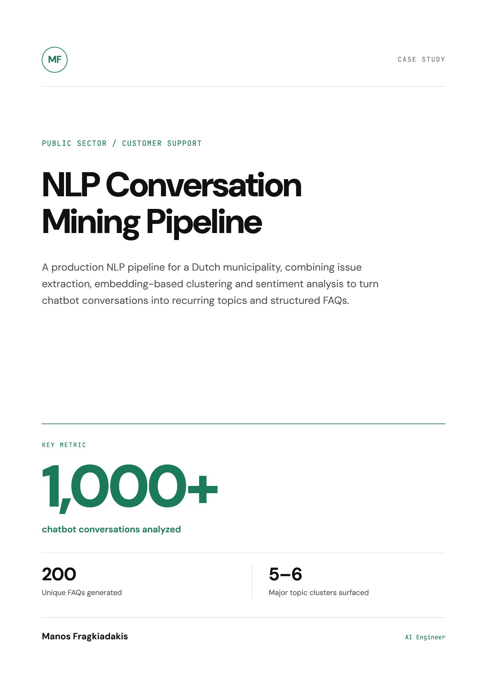
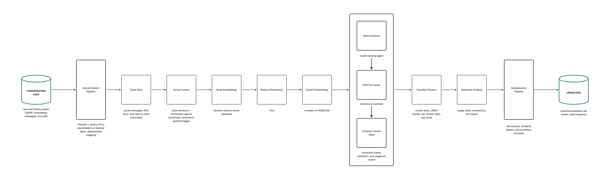

# NLP Conversation Mining Pipeline

**An NLP pipeline that turns website chatbot conversations into recurring topics, structured FAQs, and evidence for improving customer support. It analyzed 1,000+ production chatbot conversations and generated 200 unique FAQs.**

Parts of this pipeline have been open-sourced as the [Conversation Mining Pipeline](https://github.com/emfrg/conversation-mining-pipeline) so other teams can adapt the approach to their own chatbot data.

## At a glance

| Result | What it means |
| --- | --- |
| **1,000+ conversations** | Real website chatbot conversations analyzed |
| **200 unique FAQs** | Generated by combining repeated and similar questions |
| **5–6 major topics** | Clusters of recurring user issues identified |

## The situation

A production website customer-support chatbot had accumulated more than 1,000 conversations, but the team lacked a practical way to identify recurring questions, user difficulties, and gaps in the knowledge base.

The conversation history was valuable product feedback, but difficult to analyze at scale. Questions appeared in different forms, and a single conversation could contain several issues. Manually reviewing more than 1,000 transcripts was not a realistic way to identify recurring demand or gaps in the chatbot's knowledge base.

## What I built

I built a **conversation-mining pipeline** that cleans the chat history and extracts structured user issues from each conversation.

The pipeline generates embeddings for those issues and stores them in **Qdrant**. It then reduces their dimensionality and groups similar issues using **K-Means or HDBSCAN**. An LLM names the resulting clusters and identifies representative questions, making the main topics easier to inspect.

A second stage separates compound questions into individual issues, then uses vector similarity and LLM synthesis to remove duplicates and produce canonical FAQs. Sentiment, resolution status, and tool-use analysis add evidence about how the chatbot performed.

*The pipeline from raw conversation logs to deduplicated FAQs: anonymization, issue extraction, embedding, clustering, cluster naming and statistics, then deduplication.*

A **Streamlit dashboard** lets stakeholders explore the topic clusters, review the associated statistics, and inspect the underlying conversations. This connects recurring topics and performance signals to the conversations behind them.

## How it works

| Step | What happens |
| --- | --- |
| **Prepare conversations** | Clean and anonymize the raw conversation logs for analysis. |
| **Extract issues** | Identify distinct user questions and problems within each conversation. |
| **Embed and cluster** | Store embeddings in Qdrant, reduce dimensions, and group related issues with K-Means or HDBSCAN. |
| **Describe topics** | Use an LLM to name clusters, identify representative issues, and summarize recurring demand. |
| **Generate FAQs** | Split compound questions and combine duplicates through vector similarity and LLM synthesis. |
| **Analyze performance** | Examine sentiment, resolution status, and tool use to identify where the chatbot needs attention. |
| **Explore findings** | Inspect clusters, statistics, and source conversations in a Streamlit dashboard. |

**Core capabilities:** Issue extraction · Embedding clustering · Topic analysis · Sentiment analysis · User analytics

**Tech stack:** LangGraph · Vertex AI (Gemini) · Qdrant · scikit-learn · Streamlit

## Results

- **1,000+ real chatbot conversations analyzed**, extracting individual user issues from the conversation history.
- **200 unique FAQs generated**, combining repeated and similar questions through vector similarity and LLM synthesis.
- **5–6 major topic clusters identified**, revealing recurring user questions and knowledge gaps.
- **Sentiment, resolution and tool-use analysis**, with a Streamlit dashboard to inspect clusters and the conversations behind them.

Instead of manually reading conversation logs, the team had a structured view of recurring questions and concrete material for improving chatbot responses and FAQ content.

## Full case study

The designed case study is available as a PDF: [NLP Conversation Mining Pipeline](nlp-conversation-mining-pipeline.pdf).

## About Manos

Manos Fragkiadakis is an Applied AI Engineer building document intelligence and AI knowledge systems. He has over five years of Python software development experience and has built custom ERP and CRM systems for professionals. His recent work includes cited RAG across 3,000+ page legal case files and court-monitoring automation software used by 10+ law offices. He previously worked as an AI engineer and taught Natural Language Processing at Utrecht University.

[GitHub](https://github.com/emfrg) · [Upwork](https://www.upwork.com/freelancers/manosfrg)
